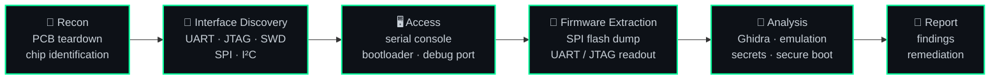

<div align="center">


[](https://linkedin.com/in/debanjansaha360)
[](https://youtube.com/@MaxTechnical360)
[](https://instagram.com/cybermax560)


</div>

---

## `$ whoami`

```yaml
handle:     CybermaX560
location:   India
role:       Hardware Security Researcher
focus:      [IoT Security, Firmware Analysis, Hardware Reverse Engineering]
interfaces: [UART, SPI, I2C, JTAG, SWD]
wireless:   [RF, Bluetooth LE, Wi-Fi, SDR]
building:   [PROBINIX, BaudHunter, Hardware-PT Toolkit]
mission: >
  Exploring the security of connected devices, embedded systems,
  and hardware through practical research and ethical security testing.
channel:    youtube.com/@MaxTechnical360
```

---

## 🚀 Featured Projects

<div align="center">

<a href="https://github.com/cybermax560-exe/PROBINIX"></a>
<a href="https://github.com/cybermax560-exe/BaudHunter"></a>
<a href="https://github.com/cybermax560-exe/Hardware-PT-ToolKIT"></a>

</div>

### 🔌 [PROBINIX](https://github.com/cybermax560-exe/PROBINIX) — hardware hacking multi-tool for RP2040


A JTAGulator-inspired tool that turns an inexpensive Raspberry Pi Pico into a debug-port finder and programmer, driven from a serial terminal menu.

- **Debug port discovery** — JTAG pinout scan (TDI/TDO/TCK/TMS/TRST across 16 channels, with device ID lookup) and SWD pinout scan
- **Target reconnaissance** — pin monitor with frequency and duty cycle, passive UART finder (1200–460800 baud), I²C scanner, SPI flash JEDEC ID
- **Hardware modes** — USB-to-serial bridge, Flashrom serprog programmer, OpenOCD adapter, CMSIS-DAP debugger

### 📟 [BaudHunter](https://github.com/cybermax560-exe/BaudHunter) — the serial port detective


Automatic baud-rate detection plus a full UART hardware-security toolkit in one binary.

- **Detection** — confidence-scored baud detection up to 4 Mbaud, framing autodetect, Modbus RTU / NMEA / MAVLink fingerprinting, sigrok-assisted auto-baud
- **Access & extraction** — U-Boot autoroot, firmware extraction over UART, XMODEM/YMODEM uploads into RAM
- **Analysis & attack** — timing side-channel assessment, protocol-aware serial fuzzer, glitch-trigger coordination
- **Interception** — passive sniffing, replay, and a MITM bridge with in-transit byte rewriting

### 🧰 [Hardware-PT Toolkit](https://github.com/cybermax560-exe/Hardware-PT-ToolKIT) — one-command hardware pentest setup


A Bash installer that turns a fresh Kali Linux system into a hardware security workstation.

- Installs **100+ packages** for firmware analysis, reverse engineering, and UART/JTAG/SWD/SPI/I²C work
- Builds firmware analysis tools from source (moria and mithril)
- Safe to re-run, unattended, and finishes with a clear installed / skipped / failed report

---

## 🔍 How I Assess a Device



| Phase | What happens | Tools I use |
|---|---|---|
| **Recon** | Board teardown, component and test-point identification | Multimeter, oscilloscope, hot-air station |
| **Interface discovery** | Locate and map debug and bus interfaces | PROBINIX, logic analyzer |
| **Access** | Reach a serial console, interrupt the bootloader, attach a debugger | BaudHunter, USB-to-TTL, ST-Link V2 |
| **Firmware extraction** | Dump flash chips or read memory through debug interfaces | XGecu T48, PROBINIX (Flashrom), BaudHunter |
| **Analysis** | Reverse engineer firmware, review boot chain and stored secrets | Ghidra, Hardware-PT Toolkit |
| **Wireless** | Inspect RF, BLE, and Wi-Fi communication | HackRF One, Wireshark |

---

## 🎯 Areas of Focus

| Domain | Topics |
|---|---|
| 🔧 **Hardware Reverse Engineering** | PCB analysis, component identification, debug interface discovery |
| 🔌 **Debug & Bus Interfaces** | UART, SPI, I²C, JTAG, SWD |
| 💾 **Firmware Security** | Firmware extraction, reverse engineering, secure boot and bootloader analysis |
| 📡 **Wireless & RF** | Bluetooth LE, Wi-Fi, SDR-based signal analysis |
| 🔍 **IoT Assessment** | End-to-end device security assessments and vulnerability research |
| ⚡ **Advanced Hardware Attacks** | Side-channel analysis, fault injection, cryptographic hardware and secure elements |
| 🛡️ **Embedded Platforms** | Embedded Linux and RTOS security |

---

## 🛠️ Tech Stack

<div align="center">


<br><br>


</div>

| Category | Skills |
|---|---|
| **Embedded languages** | C, C++, Rust, Python, Bash |
| **Platforms** | ESP32, STM32, RP2040, Arduino, Raspberry Pi, Embedded Linux |
| **Reverse engineering** | Ghidra, firmware unpacking and static analysis |
| **Network & protocol** | Wireshark, UART / SPI / I²C / JTAG / SWD protocol analysis |
| **Dev & tooling** | Git, Docker, CMake, Kali Linux |

---

## 🔬 Hardware Lab

<details>
<summary><b>🧰 Click to view lab equipment</b></summary>
<br>

| Category | Equipment | Purpose |
|---|---|---|
| RF / SDR | HackRF One | Radio-frequency and SDR research |
| Debugging | ST-Link V2 | STM32 debugging and programming |
| Debugging | PROBINIX (RP2040) | JTAG / SWD discovery, OpenOCD and CMSIS-DAP adapter |
| Targets | STM32 Blue Pill | Embedded security experiments |
| Flash programming | XGecu T48 | SPI flash reading and programming |
| Serial | USB-to-TTL adapter | UART console access |
| Measurement | Oscilloscope | Signal analysis |
| Measurement | Logic analyzer | Digital protocol analysis |
| Measurement | Multimeter | PCB and electrical analysis |
| Power | Bench power supply | Controlled power testing |
| Rework | Soldering & hot-air station | PCB rework and inspection |

</details>

---

## 📊 GitHub Activity

<div align="center">


<picture>
  <source media="(prefers-color-scheme: dark)" srcset="https://raw.githubusercontent.com/cybermax560-exe/cybermax560-exe/output/github-snake-dark.svg" />
  
</picture>

</div>

---

## 🎥 Learn With Me

I publish practical hardware security walkthroughs on YouTube — interface hunting, firmware extraction, and lab setups.

<div align="center">

[](https://youtube.com/@MaxTechnical360)

</div>

---

<div align="center">

<sub>⚠️ All research is conducted ethically on hardware I own or am authorized to test.</sub>


</div>
